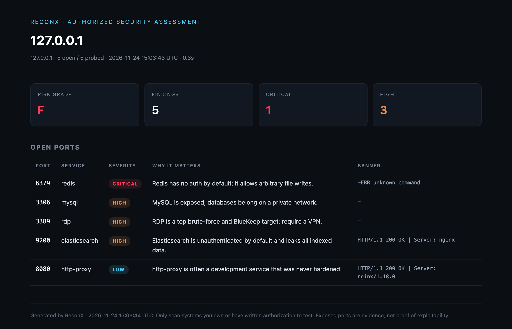

# ReconX

**A dependency-free network surface scanner that explains what it finds.**

ReconX probes TCP ports, fingerprints the service behind each one, scores the
risk of the exposure, and writes a report you can hand to somebody else. It runs
on the standard library alone — no pip install, no virtualenv, no daemon.



## Why

A port scanner that prints `6379 open` has told you almost nothing. The useful
output is *"Redis on 6379, critical: it has no authentication by default and
allows arbitrary file writes."* ReconX is built around that difference: every
open port carries a severity and a one-line rationale, the host gets a letter
grade, and the report is a file you can attach to a ticket.

It is also deliberately small. Six modules, one direction of dependency, 55 unit
tests, zero third-party packages.

## Features

- **Fast TCP probing** — bounded thread pool, per-port timeout, latency recorded.
- **Banner grabbing that adapts** — HTTP probes where HTTP belongs, silence where
  the service speaks first (SSH, FTP, SMTP, MySQL), TLS handshake + certificate
  inspection on 443/993/995/636/8443.
- **Risk classification** — 30 documented exposures, weighted into a score and an
  A–F grade, so a critical finding cannot hide in a list of open ports.
- **Service fingerprinting** — SSH, nginx, Apache, IIS, ProFTPD, Postfix, MySQL and
  more, plus end-of-life version detection.
- **Four report formats** — JSON (versioned schema), CSV, Markdown, and a
  self-contained dark HTML report with no external assets.
- **Optional Nmap enrichment** — one `-sV` run per host against open ports only,
  parsed from XML. Absent Nmap is not an error.
- **Host discovery without root** — TCP sweep of a CIDR, treating an explicit
  refusal as proof of life.
- **CI-friendly** — `--fail-on high` exits `2` when something that bad is exposed.
- **GUI** — a small Tkinter front end over the same engine.

## Install

```bash
git clone https://github.com/NicholasVormack/ReconX.git
cd ReconX
python3 -m reconx --version
```

Python 3.8+ and nothing else. To put `reconx` on your PATH:

```bash
python3 -m pip install --user -e .
```

Optional, for service/version detection: `brew install nmap` (macOS) or
`sudo apt install nmap` (Debian/Ubuntu).

## Usage

```bash
# Curated 31-port sweep
python3 -m reconx 192.168.1.10

# Specific ports, ranges and service names
python3 -m reconx 192.168.1.10 --ports ssh,80,443,8000-8010

# Every port, no banner grabbing, all four report formats
python3 -m reconx 192.168.1.10 --ports 1-65535 --no-banner

# Find live hosts first
python3 -m reconx --discover 192.168.1.0/24

# Gate a CI pipeline on high-severity exposure
python3 -m reconx staging.internal --ports 1-10000 --fail-on high

# GUI
python3 -m reconx.gui
```

### What it looks like

```
 scanning 127.0.0.1 (127.0.0.1) - 5 ports

 ReconX  127.0.0.1 (127.0.0.1)
 5 ports probed in 0.3s | 5 open
 ------------------------------------------------------------------------------
 PORT   SERVICE        SEVERITY  DETAIL
 6379   redis          critical  Redis has no auth by default; it allows arbitrary file writes.
         banner: -ERR unknown command
 3306   mysql          high      MySQL is exposed; databases belong on a private network.
 3389   rdp            high      RDP is a top brute-force and BlueKeep target; require a VPN.
 9200   elasticsearch  high      Elasticsearch is unauthenticated by default and leaks all indexed data.
 8080   http-proxy     low       http-proxy is often a development service that was never hardened.
 ------------------------------------------------------------------------------
 low=1  high=3  critical=1  |  grade F (score 34)

 reports written to /Users/you/Documents/ReconX/reconx-reports
   json  .../127.0.0.1-20261124-150343.json
   csv   .../127.0.0.1-20261124-150343.csv
   html  .../127.0.0.1-20261124-150343.html
   md    .../127.0.0.1-20261124-150343.md
```

## The risk model

Each open port resolves to a severity and a reason. The host score is the sum of
those weights; the grade is a band over the score.

| Severity | Weight | Examples |
| --- | ---: | --- |
| `critical` | 12 | telnet, unauthenticated Redis, Docker API, Memcached, rsh |
| `high` | 7 | SMB, RDP, MySQL, PostgreSQL, MongoDB, Elasticsearch, VNC, NFS |
| `medium` | 3 | FTP, MSRPC, NetBIOS, SNMP, rsync, unknown end-of-life builds |
| `low` | 1 | rpcbind, development servers on 3000/8000/8080 |
| `info` | 0 | standard web services |

| Grade | Score | Reading |
| --- | --- | --- |
| A | 0 | Nothing notable exposed |
| B | 1–3 | Low-severity services only |
| C | 4–8 | Worth fixing this sprint |
| D | 9–16 | High-severity exposure |
| F | 17+ | Critical exposure |

## Reports

`--formats json,csv,html,md` writes any subset into a timestamped directory.
Reports are sorted by severity, so the thing that matters is the first row.

The JSON payload is versioned (`reconx.report/2`) and safe to consume from other
tooling:

```json
{
  "schema": "reconx.report/2",
  "target": "10.0.0.5",
  "risk_grade": "F",
  "findings": [
    {
      "port": 6379,
      "service": "redis",
      "severity": "critical",
      "note": "Redis has no auth by default; it allows arbitrary file writes.",
      "latency_ms": 0.9
    }
  ]
}
```

## Library use

```python
from reconx import parse_ports, scan_host, write_reports

result = scan_host("10.0.0.42", ports=parse_ports("22,80,443"), timeout=1.0)
print(result.risk_grade, result.risk_score)

for finding in result.open_findings:
    print(finding.port, finding.service, finding.severity.value, finding.note)

write_reports(result, "reports", formats=("json", "html"))
```

## How it works

```
services.py   pure: port registry, banner fingerprints, risk rules, probe choice
    |
engine.py     sockets: thread pool, probe, banner, TLS, host sweep
    |
nmapbridge.py optional: one nmap -sV per host, XML parsed
    |
report.py     JSON / CSV / Markdown / HTML
    |
cli.py  gui.py
```

Details, including why Nmap is optional and why classification is a pure
function, are in [docs/ARCHITECTURE.md](docs/ARCHITECTURE.md). The full flag
reference and recipes are in [docs/USAGE.md](docs/USAGE.md).

## Tests

```bash
python3 -m unittest discover -s tests -t .
```

55 tests covering port-spec parsing, target validation, fingerprinting, risk
classification, report rendering and escaping, Nmap XML parsing, and live scans
against a socket the test binds itself. No network access required.

## Authorized use

**Only scan systems you own or have written permission to test.** Unauthorized
scanning is a computer-crime offence in the US, UK, EU and most other
jurisdictions, even when nothing is exploited. Read
[docs/ETHICS.md](docs/ETHICS.md) before pointing this at anything.

ReconX does no exploitation, no credential attacks, and has no stealth mode. It
reports exposure so exposure can be closed.

## License

MIT. See [LICENSE](LICENSE).
